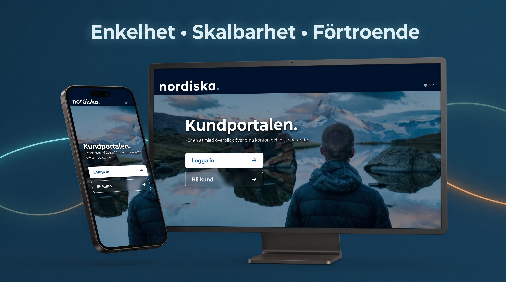
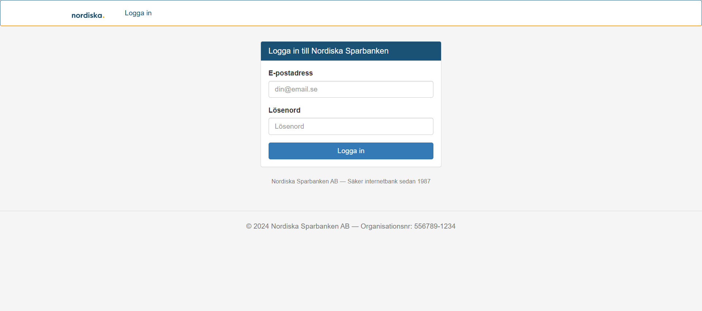
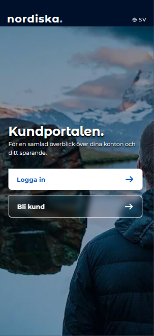
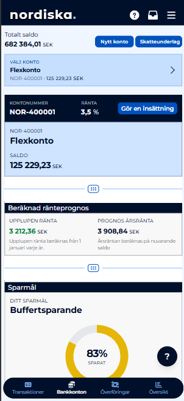
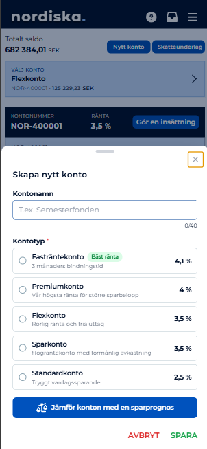

# Nordiska Sparbanken v2

Check out the deployed [Live demo](https://nordiska-team1-dev.team.chas-challenge.comerit.se/)!

## The problem

As Nordiska Sparbanken moves into direct consumer banking, routine requests such as checking accrued interest, confirming a balance, or ordering annual tax documents go through support queues and postal correspondence. That is about 500 support tickets a week for questions customers should be able to answer themselves, and it does not match the clear, trustworthy experience a retail bank needs.

## Our solution

**Customer portal**
- Overview of all accounts with real-time accrued interest and growth forecasts against savings goals
- Deposits and withdrawals with multi-step confirmations
- Account statements and annual tax reports (`Skatteunderlag`), cryptographically signed and downloadable on demand
- FAQ with full-text search and relevance ranking
- One inbox for support threads, bank notices, and delivered documents
- BankID sign-in with 15-minute sessions

**Admin portal**
- Customer threads with status tracking and response auditing
- FAQ editing, guided by search analytics and customer helpfulness votes (up/down)
- System-wide notices and scheduled maintenance messages

<table>
<tr>
<td align="center" width="50%">

**Before**

*Legacy interface*

</td>
<td align="center" width="50%">

**After**

*Self-service customer portal*

</td>
</tr>
</table>

<b>Mobile screenshots</b>

<table>
<tr>
<td align="center" width="33%"></td>
<td align="center" width="33%"></td>
<td align="center" width="33%"></td>
</tr>
</table>

## Architecture

- **Modular monolith.** Four modules (Banking, Reporting, FAQ, Inbox), each with its own PostgreSQL schema and least-privilege database role.
- **Job queue on PostgreSQL.** Workers claim jobs with `FOR UPDATE SKIP LOCKED`, so concurrency needs no extra locking layer.
- **Native PDF engine.** C++23, called in-process by the worker through a C ABI. See [Native PDF Generator](native/pdf_generator/README.md) and [ADR: Jimmy Jordan](native/pdf_generator/ADR_jimmy_jordan.md).
- **Isolated signer.** A separate PKCS#11 service, called by the native PDF engine over a Unix domain socket, so signing keys never share memory or process space with the application or worker. See [Native PDF Signer](native/pdf-signer/README.md) and [ADR: Marcus Mandelström](native/pdf-signer/beslutslogg.md).
- **Benchmark performance.** In stress tests on an 8-core laptop with 10,000 synthetic customers (15,444 accounts, 733k+ transactions), the full pipeline generated and CMS-signed all **25,448 PDF documents in 52.5 seconds** (485 PDFs/s) with zero errors. Pure in-memory C++ generation and socket signing took **6.16 seconds** (over 4,100 PDFs/s, ~3.7 ms/doc).

| Layer | Technologies |
| :--- | :--- |
| **Backend** | ASP.NET Core 8, EF Core 8, BCrypt.Net-Next, ActiveLogin BankID, Polly, FluentValidation, Serilog |
| **Frontend** | React 18, TypeScript, Vite, TailwindCSS, Zustand, TanStack Query, Framer Motion, i18n, fuse.js |
| **Native engine** | C++23, libharu, Cairo, simdjson, nlohmann-json, OpenSSL 3.0+, CMake + Ninja, CTest |
| **Security & signing** | PKCS#11, CMS/PKCS#7 signing, RFC 3161 timestamps |
| **Infrastructure** | PostgreSQL 15, Docker Compose, GitHub Actions CI, multi-stage Dockerfiles |

## Security

- **Transfers:** immutable double-entry ledger with `SELECT FOR UPDATE` row locking, so balances cannot race.
- **Sessions:** `HttpOnly`, `SameSite=Lax`, `Secure` cookies; 15-minute tokens with sliding refresh and automatic 5-minute inactivity logout.
- **Credentials:** BCrypt (work factor 12); SCRAM-SHA-256 for database connections.
- **Signed documents:** CMS/PKCS#7 signatures with RFC 3161 timestamps; signing isolated in its own service.
- **Privacy in logs:** native diagnostics use fixed error codes, so customer PII never reaches log output.
- **Containers:** non-root users, strict UID isolation, read-only mounts where appropriate.

## Project Deliverables & Decision Logs

Comprehensive project documentation, requirements fulfillment, and architecture decisions for the Chas Challenge 2026 delivery:

- **Final Project Report:** [CHAS_REPORT.md](CHAS_REPORT.md) — Unified delivery report detailing requirement fulfillment, testing status, specialist feed-forward, high-level decision logs, and demo contingency plans.
- **Run, Install & Test Guide:** [DEVELOPMENT.md](DEVELOPMENT.md) — Comprehensive guide for environment bootstrapping, Docker Compose orchestration, frontend HMR, synthetic database seeding, and local native compilation.
- **Architecture Decision Records (ADR) & Decision Logs:**
  - **Native PDF Generator:** [ADR: Jimmy Jordan](native/pdf_generator/ADR_jimmy_jordan.md) — In-process C ABI, 3-stage pipeline, zero-knowledge signing, and memory optimization.
  - **PDF Signing & PKI:** [Decision Log: Marcus Mandelström](beslutslogg.md) — PKCS#11, CMS/PAdES, and RFC 3161 TSA architecture.
  - **Backend:** [ADR 0001 (Architecture & Transaction Patterns)](backend/docs/internal/ADR001.md) and [ADR 0002 (Database Security & RBAC)](backend/docs/internal/ADR002.md).
  - **Frontend:** [Frontend Decision Log](frontend/README.md).
- **Module READMEs & Test Status:**
  - **Native PDF Generator:** [native/pdf_generator/README.md](native/pdf_generator/README.md) — Architecture, CLI options, integration contracts, and test status (17/17 CTest Debug with ASan/UBSan, 13/13 Release).
  - **Frontend:** [frontend/README.md](frontend/README.md)
  - **Backend:** [backend/README.md](backend/README.md)

## Run it

Running and development instructions are found in [DEVELOPMENT.md](DEVELOPMENT.md).

## Team

Built by Nordiska Team 1 for Chas Challenge 2026.

| Team member | Focus | Profile |
| :--- | :--- | :--- |
| **Alexander Jansson** | Backend Architecture | [GitHub](https://github.com/AlexanderJson) |
| **Coday Awahmed** | Backend Architecture | [GitHub](https://github.com/Coday-aw) |
| **Dennis Cederqvist** | Frontend Engineering | [GitHub](https://github.com/DennisCederqvist) |
| **Ingrid Berggren** | Frontend Engineering | [GitHub](https://github.com/ingridber) |
| **Jimmy Jordan** | Native Systems & Performance | [GitHub](https://github.com/jimmyjordanSWE) · [ADR](native/pdf_generator/ADR_jimmy_jordan.md) |
| **Joco Borghol** | Backend Architecture | [GitHub](https://github.com/JocoBorghol) |
| **Marcus Mandelström** | Native Systems & Security | [GitHub](https://github.com/mmandelstrom) · [Decision Log](beslutslogg.md) |
| **Olle Warne** | Frontend Engineering | [GitHub](https://github.com/ollewarne) |
| **Vivienne Bengtsson** | Backend Architecture | [GitHub](https://github.com/BwunLevain) |

**Project leadership:** [Linus Ivarsson](https://www.linkedin.com/in/linus-ivarsson-44379671/)
