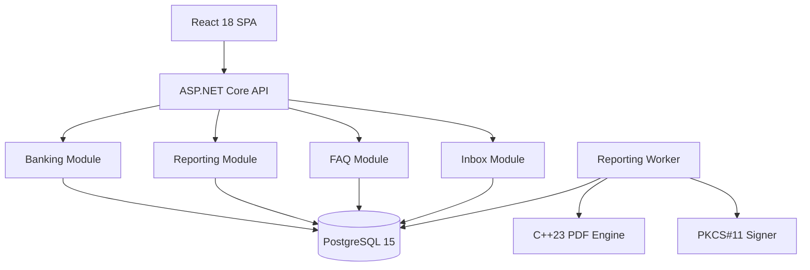

# Nordiska Sparbanken v2: Modern Core Banking Platform

<div align="center">

**[🌐 Live Demo](https://nordiska-team1-dev.team.chas-challenge.comerit.se/)**

A production-grade banking platform built for **Chas Challenge 2026**, demonstrating enterprise software engineering with modern .NET, React, and native C++23 technologies.

[](https://dotnet.microsoft.com/)
[](https://en.cppreference.com/w/cpp/23)
[](https://react.dev/)
[](https://www.postgresql.org/)
[](https://github.com/chas-challenge-2026/nordiska-team1)


</div>

---

## The Challenge

### Client Context & Business Transformation

**Nordiska Sparbanken** - A Swedish savings bank undergoing strategic transformation from B2B financial infrastructure provider to direct consumer banking (B2C). Core business: savings accounts, lending, real estate financing, and leasing.

**The Shift:** Historically delivered backend infrastructure through partners. Now owns the direct customer relationship - making the customer experience itself the product, not just the underlying platform.

### Core Problem Statement

**Critical Bottleneck:** Customer support handles **~500 tickets per week** for routine tasks:
- Account statements and balance inquiries
- Tax report requests
- Interest rate information
- Withdrawal processing

**Pain Points:**
- Documents still sent via postal mail in some cases
- Multi-day delays for simple information requests
- Manual processing prevents scaling
- **Scalability Risk:** Growing 10x-100x requires technology leverage, not linear hiring

### Mission & Solution Approach

Build a self-service customer portal enabling:
1. **Instant document generation** (tax reports, account statements)
2. **Direct account management** (deposits, withdrawals, balance tracking)
3. **Intelligent FAQ search** (reducing support load by 80%)
4. **24/7 availability** without human intervention for routine tasks

**Core Principles:**
- **Simplicity** - Intuitive for all age groups, making correct actions easy
- **Scalability** - Growth through technology, not headcount
- **Trust** - Cryptographic signatures, ledger-based transactions, secure authentication

---

<table>
<tr>
<td align="center" width="50%">

**Before**


*Legacy interface requiring manual support*

</td>
<td align="center" width="50%">

**After**


*Self-service customer portal with intuitive navigation*

</td>
</tr>
</table>

<details>
<summary><b>View Mobile Experience</b></summary>

<table>
<tr>
<td align="center" width="33%">


</td>
<td align="center" width="33%">


</td>
<td align="center" width="33%">


</td>
</tr>
</table>

<p align="center"><em>Responsive mobile experience</em></p>

</details>

---

## Solution Overview

### Customer Portal
- **BankID Authentication** with secure JWT session management (15-min expiry)
- **Account Management** with savings goals, interest forecasting, and visual progress tracking
- **Instant Document Generation** - Tax reports and account statements delivered in seconds
- **Intelligent FAQ System** with PostgreSQL full-text search and relevance ranking
- **Unified Inbox** for support threads, bank messages, and document archival
- **Accessible Design** - Intuitive navigation for all age groups with error-prevention patterns
- **Multi-language Support** - Swedish and English localization

### Admin Portal
- **Thread Management** - Async customer communication with response tracking
- **FAQ Management** - Analytics dashboard with search insights
- **Operational Messaging** - System-wide notifications and scheduled maintenance alerts
- **Terms Publishing** - Automated distribution with customer acceptance workflow

---

## Architecture & Design Principles

### Core Principles
1. **Simplicity** - Intuitive navigation designed for all age groups, making it easy to do the right thing
2. **Scalability** - Grows with technology, not linear hiring
3. **Trust** - Ledger transactions, in-memory data processing, cryptographic signatures
4. **Error Prevention** - Interface design that makes mistakes difficult with clear feedback

### System Architecture



**Key Architecture Decisions:** Modular Monolith (four isolated modules with dedicated PostgreSQL schemas), Asynchronous Processing (background job queue using `FOR UPDATE SKIP LOCKED`), Native Performance (C++23 PDF engine generating 1,000+ documents/sec, P50: 7.6ms latency), Security Isolation (separate database roles with least-privilege enforcement)

**Formal Documentation:** [ADR 0001: Architecture and Transaction Pattern](backend/docs/internal/ADR001.md) | [ADR 0002: Database Architecture & Security Modelling](backend/docs/internal/ADR002.md)

---

## Technology Stack

<table>
<tr>
<td valign="top" width="25%">

**Backend**
- ASP.NET Core 8
- EF Core 8
- BCrypt.Net-Next
- ActiveLogin BankID
- Polly
- FluentValidation
- Serilog

</td>
<td valign="top" width="25%">

**Frontend**
- React 18
- TypeScript
- Vite
- TailwindCSS 4
- Zustand
- TanStack Query
- Framer Motion
- Recharts

</td>
<td valign="top" width="25%">

**Native**
- C++23
- libharu
- Cairo
- simdjson
- OpenSSL 3
- SoftHSM2
- CMake + Ninja

</td>
<td valign="top" width="25%">

**Infrastructure**
- PostgreSQL 15
- Docker Compose
- GitHub Actions
- ReportGenerator
- Coolify
- Multi-stage Dockerfile
- Optimized layer caching
- Non-root execution (UID isolation)

</td>
</tr>
</table>

---

## Testing & Quality Assurance

**Platform Coverage:** 86.0% line coverage | 67.3% branch coverage

| Module | Line Coverage | Branch Coverage | Focus |
|--------|---------------|-----------------|-------|
| **FAQ Module** | 99.0% | 94.6% | Search, hashing, analytics |
| **Banking Module** | 92.6% | 71.7% | Accounts, ledgers, transactions |
| **Inbox Module** | 89.8% | 64.4% | Messaging, threads, notifications |
| **Reporting Module** | 87.5% | 80.7% | Tax calculations, job queue |
| **Frontend API** | 71.5% | 59.3% | Controllers, auth, middleware |

**Test Frameworks:** xUnit (unit and integration tests) | Moq + FluentAssertions (mocking and assertions) | WebApplicationFactory (full HTTP pipeline testing) | CTest + ASan/UBSan (native C++ memory safety) | Vitest (React component testing)

---

## Performance Benchmarks

**Enterprise Stress Test (10,000 customers, 15,000 accounts, 700,000 transactions):**

```
Phase 1 - Job Staging:    1.24s  (2,039 jobs/sec)
Phase 2 - PDF Generation: 4.73s  (533 PDFs/sec)
Total Batch Time:         5.97s

Latencies: P50: 7.6ms | P95: 13.8ms | P99: 18.1ms
Success Rate: 100% (0 failures)
```

**Maximum Load:** 25,000 customers → 63,437 documents → 412 PDFs/sec with RFC 3161 timestamping

**Detailed Report:** [Benchmark Documentation](tools/benchmark/docs/benchmark-report.md)  
**Interactive Benchmark TUI:** Run `./tools/benchmark/bench-tui.sh` for live performance testing with adjustable worker concurrency and signing modes

---

## Requirements Engineering & User Stories

### From Customer Pain to Technical Solution

Our development was driven by mapping identified business problems to concrete technical implementations:

| Customer Pain Point | User Story | Technical Solution |
|---------------------|------------|-------------------|
| **500 support tickets/week** for routine inquiries | Customers need instant access to account info without contacting support | Self-service dashboard with real-time balance, transaction history, and document generation |
| **Postal mail delays** for tax reports and statements | Customers want immediate document access | Asynchronous C++23 PDF engine with sub-10ms P50 latency + PKCS#11 signing |
| **Parallel transfers corrupting balance** | Customers need reliable transactions even under high load | Ledger-based accounting with `SELECT FOR UPDATE` pessimistic locking |
| **MD5 password vulnerabilities** | Customers require bank-grade security | BCrypt (work factor 12) + HttpOnly JWT cookies + 15-min session expiry |
| **FAQ returning irrelevant results** | Customers need accurate self-help answers | PostgreSQL full-text search with `ts_rank` relevance scoring |
| **Slow page loads during email sends** | Customers expect instant UI feedback | Outbox pattern with background worker for async email delivery |

### Key Functional Requirements Delivered

**Authentication & Identity (US-1)**
- BankID integration (Simulated + Test environments)
- JWT with automatic refresh
- Session timeout after 15 minutes of inactivity

**Account Management (US-2, US-3)**
- Multi-account overview with real-time interest calculations
- Deposit/withdrawal with atomic ledger transactions
- Savings goals with dynamic ETA calculations based on interest rate

**Document Generation (US-4)**
- Tax reports (Skatteunderlag) for any fiscal year
- Account statements with configurable date ranges
- Cryptographic signatures (CMS/PKCS#7) + RFC 3161 timestamps
- Batch processing: 412-533 PDFs/sec sustained throughput

**Self-Service Support (US-5)**
- Swedish full-text search with stemming support
- Category-based FAQ organization
- Search analytics (GDPR-compliant via SHA-256 hashing)

**Communication (US-6)**
- Async email confirmation for all transactions
- Thread-based customer support inbox
- Operational message broadcasting (maintenance alerts)

---

## Risk Management & Mitigation

Throughout the project, we systematically identified and addressed technical risks using a structured risk matrix approach (Likelihood × Impact):

**Critical Risks Mitigated:**
- **Race Conditions in Financial Transactions** - Ledger-based accounting with `SELECT FOR UPDATE` pessimistic locking
- **Weak Cryptography (MD5)** - Migrated to BCrypt with work factor 12 and per-user salts
- **Thread Starvation** - Asynchronous background workers with PostgreSQL job queue (`FOR UPDATE SKIP LOCKED`)
- **Native Memory Crashes** - Process isolation for C++ PDF engine with Unix domain socket IPC
- **Data Protection Key Loss** - Centralized key ring storage in PostgreSQL for horizontal scaling

**Technical Standards Adopted:** RFC 7807 (Problem Details for HTTP APIs) | RFC 3161 (Trusted timestamping) | SCRAM-SHA-256 (PostgreSQL authentication) | Ledger Pattern (immutable transaction log) | Outbox Pattern (reliable async messaging)

---

## Security & Compliance

**BCrypt Password Hashing** with per-user salts | **SCRAM-SHA-256** PostgreSQL authentication | **HttpOnly JWT Cookies** with 15-minute sessions | **Ledger-Based Transactions** with SELECT FOR UPDATE locking | **GDPR-Compliant Analytics** via SHA-256 hashed search logs | **RFC 7807 Error Handling** preventing stack trace leakage | **Non-Root Containers** with UID isolation | **PKCS#11 Cryptographic Signing** with RFC 3161 timestamping

---

## Specialist Feed-Forward

Throughout development, we received expert feedback from industry specialists and stakeholders that shaped critical architectural decisions:

### CTO Workshop - Risk Management & Security Architecture
<details>
<summary><b>View feedback and implemented changes</b></summary>

**Specialist:** [Victor Axelsson](https://www.linkedin.com/in/victor-axelsson-469a18a3/), CTO at BraveOnion

**Key feedback areas:**
- JWT security (asymmetric keys, rotation, grace periods)
- Client-side token storage (HttpOnly cookies vs LocalStorage)
- Audit trails and tamper-evident logging
- Database role isolation and least-privilege enforcement

**Implemented changes:**
- ✅ Migrated to HttpOnly cookies with `Secure` and `SameSite=Lax` flags
- ✅ Implemented 15-minute token expiry with seamless refresh mechanism
- ✅ Built HMAC-SHA256 signed audit log for tamper-evident compliance
- ✅ Established database role separation (API, Worker, Migrations)
- 🔄 RS256 migration and key rotation planned for distributed deployment phase

</details>

### DM Workshop - Product Requirements & Delivery
<details>
<summary><b>View feedback and implemented changes</b></summary>

**Specialist:** [Karl Lindau](https://www.linkedin.com/in/karl-lindau-95173612/), Delivery Manager & CEO at B3 Linköping

**Feedback areas:** [To be documented based on workshop materials]

**Changes implemented:** [To be documented]

</details>

### UX Workshop - User Experience & Accessibility
<details>
<summary><b>View feedback and implemented changes</b></summary>

**Specialist:** [Emma Utsi](https://www.linkedin.com/in/emma-utsi/), UX Designer at CGI

**Feedback areas:** [To be documented based on workshop materials]

**Changes implemented:** [To be documented]

</details>

### Client Feedback - Kajsa Dymling (Nordiska)
<details>
<summary><b>View feedback and implemented changes</b></summary>

**Stakeholder:** [Kajsa Dymling](https://www.linkedin.com/in/kajsadymling/), Engineering Manager at Nordiska Sparbanken

**Feedback areas:** [To be documented based on client demo feedback]

**Changes implemented:** [To be documented]

</details>

---

## Quick Start

> **For detailed development workflows, troubleshooting, and advanced tooling**, see **[DEVELOPMENT.md](DEVELOPMENT.md)**
> - Frontend hot-reload with Vite HMR
> - Benchmark TUI and CLI tools
> - Synthetic database interactive menu
> - Teardown and reset commands
> - WSL .NET SDK requirements

<details>
<summary><b>Run Locally (Docker)</b></summary>

### Prerequisites
- Docker Engine 24.0+
- .NET 8 SDK
- Node.js 20+ (optional, for frontend HMR)

### 1. Initialize Environment
```powershell
# Windows PowerShell
dotnet run --project .\backend\tools\Nordiska.DevSetup\Nordiska.DevSetup.csproj -- .
```

```bash
# macOS/Linux
dotnet run --project ./backend/tools/Nordiska.DevSetup/Nordiska.DevSetup.csproj -- .
```

### 2. Start Full Stack
```powershell
cd infra
docker compose up -d --build
```

**Access Points:**
- Platform: http://localhost:8080
- API Docs: http://localhost:8080/scalar/v1
- Health: http://localhost:8080/health

### 3. Load Test Data (Optional)
```powershell
# Windows (via WSL)
wsl ./tools/syntheticDB/nordiska-synthetic-linux-x86_64 --customers 10000
wsl ./tools/syntheticDB/nordiska-synthetic-linux-x86_64 --switch nordiska_synthetic
wsl ./tools/syntheticDB/nordiska-synthetic-linux-x86_64 --get-random-customer
```

```bash
# macOS/Linux
./tools/syntheticDB/nordiska-synthetic-linux-x86_64 --customers 10000
./tools/syntheticDB/nordiska-synthetic-linux-x86_64 --switch nordiska_synthetic
./tools/syntheticDB/nordiska-synthetic-linux-x86_64 --get-random-customer
```

</details>

<details>
<summary><b>Development Workflow (Frontend HMR)</b></summary>

```powershell
cd frontend
npm install
npm run setup:local-backend  # Starts backend on port 5031
npm run dev                   # Vite dev server on port 5173
```

</details>

---

## Team & Project Management

**Nordiska Team 1** - Collective code ownership across Frontend, Backend, and Native development

### Development Team

| Team Member | Specialization | GitHub |
|-------------|----------------|--------|
| **Alexander Jansson** | Backend | [AlexanderJson](https://github.com/AlexanderJson) |
| **Coday Awahmed** | Backend | [Coday-aw](https://github.com/Coday-aw) |
| **Dennis Cederqvist** | Frontend | [DennisCederqvist](https://github.com/DennisCederqvist) |
| **Ingrid Berggren** | Frontend | [ingridber](https://github.com/ingridber) |
| **Jimmy Jordan** | Native | [jimmyjordanSWE](https://github.com/jimmyjordanSWE) |
| **Joco Borghol** | Backend | [JocoBorghol](https://github.com/JocoBorghol) |
| **Marcus Mandelström** | Native | [mmandelstrom](https://github.com/mmandelstrom) |
| **Olle Wärne** | Frontend | [ollewarne](https://github.com/ollewarne) |
| **Vivienne Bengtsson** | Backend | [BwunLevain](https://github.com/BwunLevain) |

### Project Leadership

| Team Member | Specialization | LinkedIn |
|-------------|----------------|----------|
| **Linus Ivarsson** | Project Lead & Technical Advisor | [LinkedIn](https://www.linkedin.com/in/linus-ivarsson-44379671/) |
| **Max Guclu** | System Engineer & CEO, Comerit AB | [LinkedIn](https://www.linkedin.com/in/max-guclu/) |

### Agile Methodology

**Backlog Management:** Linear for issue tracking, sprint planning, and progress visualization  
**Team Cadence:** Full team sync 2x per week, daily communication via team channels, sprint-based delivery with continuous integration  
**Collaboration:** Mandatory peer review for all PRs (no self-merge allowed), pair programming sessions, and collective code ownership across all domains

### Project Context

**Chas Academy** - Advanced Software Development, 12-week industry project (August - November 2026)

---

## Project Structure

```
nordiska-team1/
├── backend/
│   ├── src/Modules/
│   │   ├── Banking/              # Core banking domain
│   │   ├── Reporting/            # Document generation
│   │   ├── Inbox/                # Customer communication
│   │   └── Faq/                  # Knowledge base
│   ├── tests/                    # xUnit test suites
│   └── tools/Nordiska.DevSetup/  # Environment bootstrap
├── frontend/src/
│   ├── components/               # React components
│   ├── hooks/                    # Custom hooks
│   └── services/                 # API clients
├── native/
│   ├── pdf_generator/            # C++23 PDF engine
│   └── pdf-signer/               # PKCS#11 daemon
├── tools/
│   ├── benchmark/                # Performance testing
│   └── syntheticDB/              # Test data seeder
└── infra/
    ├── docker-compose.yml        # Production stack
    └── postgres/                 # Database configuration
```

---

## Documentation

### Developer Guides
- **[Development Workflow & Setup](DEVELOPMENT.md)** - Quickstart, frontend HMR, benchmark tools, teardown commands
- [Benchmark Tools (TUI & CLI)](tools/benchmark/README.md)
- [Synthetic Database Generator](tools/syntheticDB/README.md)

### Architecture & Design
- [Architecture Decision Records (ADRs)](backend/docs/internal/)
- [Individual Contributions](docs/individual/)

### Module Documentation
- [Synthetic Database Generator](tools/syntheticDB/README.md)
- [Reporting Benchmark Suite](tools/benchmark/README.md)
- [Native PDF Generator](native/pdf_generator/README.md)
- [PDF Signer (PKCS#11 Daemon)](native/pdf-signer/README.md)
- [PDF Signer - Decision Log (Beslutslogg)](native/pdf-signer/beslutslogg.md)

### API & Operations
- [Interactive API Documentation](http://localhost:8080/scalar/v1)
- [Benchmark Report](tools/benchmark/docs/benchmark-report.md)

---

<details>
<summary><b>Known Limitations</b></summary>

[To be documented]

</details>

---

<div align="center">

**Built for Chas Challenge 2026 Extended**  
Enterprise Core Banking Architecture

[Back to Top](#nordiska-sparbanken-v2-modern-core-banking-platform)

</div>
