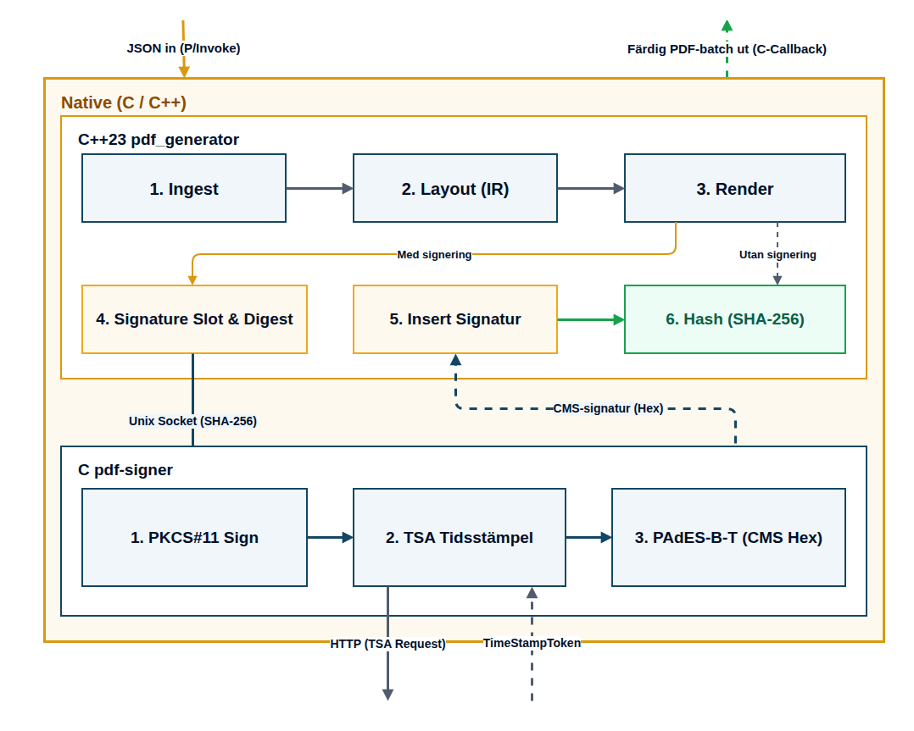

# Native-moduler

| Modul | Ansvar | Dokumentation |
| --- | --- | --- |
| `pdf_generator/` | C++23-bibliotek som omvandlar en kunds JSON-underlag till kontoutdrag och skatteunderlag i PDF-format. | [README](pdf_generator/README.md) |
| `pdf-signer/` | C-tjänst som tar emot en SHA-256-digest och returnerar en CMS-signatur, med valfri RFC 3161-tidsstämpel. | [README](pdf-signer/README.md) |

## Rapportflöde

Diagrammet visar flödet från MVP-presentationen. Signering och tidsstämpel är valfria. V2-gränssnittet tillhandahåller dokumentets hash; den nuvarande .NET-workern använder V1.

## Integration

.NET-workern laddar generatorns delade bibliotek via P/Invoke. Varje synkront C ABI-anrop omfattar en kunds dokument. Generatorn och workern delar process; PDF-resultaten lånas under callbacken och måste användas eller kopieras innan den avslutas.

När signering används kommunicerar generatorns adapter med signeringstjänsten via en Unix-socket. Själva tjänsten och den lokala TSA:n kör som separata processer. Generatorns kärna skriver inte PDF-filer; CLI-programmet och .NET-värden har egna ansvar för filutmatning respektive lagring.

Byggkrav, körinstruktioner, tidsgränser och integrationskontrakt finns i respektive moduls README. Anvisningar om en äldre separat generatorprocess eller IPC med hela kundunderlag beskriver inte den nuvarande integrationsmodellen.