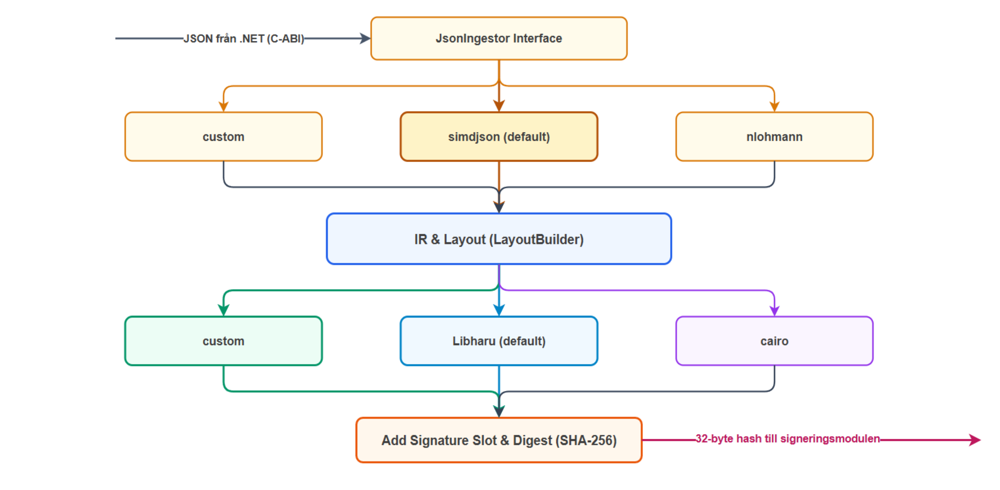

# Native PDF-generator

## Innehåll

- [Funktioner](#funktioner)
- [Arkitektur](#arkitektur)
- [Renderare och JSON-tolkning](#renderare-och-json-tolkning)
- [Miljövariabler](#miljövariabler)
- [JSON-underlag](#json-underlag)
- [Integrationskontrakt](#integrationskontrakt)
- [Köra från terminalen](#köra-från-terminalen)
- [Testning och kodkvalitet](#testning-och-kodkvalitet)
- [Prestanda](#prestanda)
- [Begränsningar](#begränsningar)
- [Möjliga framtida förbättringar](#möjliga-framtida-förbättringar)

## Om

C++23-bibliotek som skapar kontoutdrag och årliga skatteunderlag från JSON.
Varje anrop innehåller underlagen för exakt en kund.

Det finns också ett CLI för att skapa PDF-filer direkt från en JSON-fil.

Anroparen väljer kunduppgifter, beräknar belopp och formaterar värdena som ska
visas. Generatorn läser underlaget, placerar innehållet på sidorna och skapar
PDF-dokumenten, med valfri digital signering.

## Funktioner

- **Utbyggbar JSON-inläsning**: nya tolkar kan läggas till bakom ett gemensamt
  gränssnitt. I dag finns simdjson och nlohmann.
- **Utbyggbar PDF-rendering**: nya motorer kan läggas till och använda samma
  mellanrepresentation. I dag finns Haru, Native och Cairo.
- **Utbyggbara dokumenttyper**: definiera dokumentets data och layout i den
  gemensamma mellanrepresentationen; befintliga PDF-motorer sköter renderingen.
- **Mellanrepresentation av dokumentens layout**, som skiljer layout från rendering
  och ger en grund för en framtida grafisk layout- och mallredigerare.
- **Prestanda**: generering i minnet med återanvända arbetsbuffertar för färre
  allokeringar. Oberoende kundanrop kan köras parallellt.
- **PDF-komprimering** för mindre filer, aktiverad som standard.
- **Valfri digital signering och tidsstämpling** via en extern signerare.
- **Enkelt C-ABI** för integration med andra språk, samt CLI för direkt användning.
- **Konfiguration via miljövariabler** för bland annat PDF-motor och signering.

## Arkitektur



JSON-tolkningen skapar interna dokumentdata. Layoutsteget bestämmer var text,
linjer och bilder ska placeras. PDF-motorn omvandlar sedan layouten till PDF.
Vid signering skickas dokumentets hash till den externa signeraren, och den
returnerade signaturen läggs in i PDF-dokumentet.

Koden följer samma uppdelning i `src/ingestion/`, `src/layout/`, `src/rendering/`
och `src/signing/`. `src/c_api/` innehåller C-gränssnittet och `cli/`
kommandoradsprogrammet. Biblioteket arbetar i minnet; CLI-programmet skriver filer.
Textvärden från JSON kopieras till interna datastrukturer.

I dag finns kontoutdrag och årliga skatteunderlag. För en ny dokumenttyp definieras
vilka data den behöver, JSON-inläsningen kompletteras vid behov och en layout
byggs med mellanrepresentationens text, linjer, rektanglar och bilder.
Samma PDF-motorer kan sedan rendera den nya typen.

## Renderare och JSON-tolkning

Layouten kan omvandlas till PDF med tre olika motorer:

| Motor | Beskrivning |
| --- | --- |
| `haru` | Standardalternativet, byggt på libharu. |
| `native` | Egen PDF-motor med PDF:s standardtypsnitt. |
| `cairo` | Alternativ för funktionstestning. Bäddar in typsnittsdelar och är för långsam för den här modulens massgenerering. |

CLI väljer motor med `--renderer`. För biblioteksanrop används miljövariabeln
`NORDISKA_PDF_ENGINE`. Haru är standard. JSON läses med simdjson;
CLI kan även välja nlohmann med `--ingestor`.

## Miljövariabler

Sätt variablerna i miljön för processen som använder biblioteket.

| Variabel | Betydelse och standardvärde |
| --- | --- |
| `NORDISKA_PDF_ENGINE` | PDF-motor: `haru` (standard), `native` eller `cairo`. Även CLI läser variabeln; `--renderer` har företräde. |
| `NORDISKA_PDF_ENABLE_SIGNING` | C-ABI: `1` eller `true` aktiverar signering; andra värden stänger av. Om variabeln saknas aktiveras signering när signerarsocketen är läs- och skrivbar. CLI använder i stället `--signing`. |
| `PDF_SIGNER_SOCKET_PATH` | Signerarens Unix-socket. Standard: `/run/pdf-signer/pdf-signer.sock`. |
| `PDF_SIGNER_MODE` | `timestamp` eller `1` begär tidsstämpel. Annars signering utan tidsstämpel. |
| `NORDISKA_PDF_SIGNER_TIMEOUT_MS` | Tidsgräns för ett signeraranrop per dokument, i millisekunder. Standard: `10000`. Tillåtna värden: `1–2147483647`. |
| `NORDISKA_PDF_MAX_PAYLOAD_BYTES` | Maximal JSON-storlek via C-ABI, i byte. Standard: `33554432` (32 MiB). |
| `NORDISKA_PDF_HARU_BASE_CHUNK_BYTES` | Harus grundstorlek för återanvändbart arbetsminne, i byte. Standard: `2097152` (2 MiB). |
| `NORDISKA_PDF_HARU_MAX_ARENA_BYTES` | Övre gräns för Harus minnesarena, i byte. Standard: `33554432` (32 MiB). |

JSON-tolk och komprimering väljs med CLI-flaggor (`--ingestor` och
`--compression`), inte miljövariabler. C-ABI använder simdjson och komprimering.

## JSON-underlag

Utgå från [det fullständiga JSON-exemplet](docs/golden_customer_batch_sample.json),
som visar en kund med både kontoutdrag och skatteunderlag. Samma format används
av C-ABI och CLI: `customer_id` identifierar kunden och `documents` innehåller
posterna med `document_id`, dokumenttypen `kind` och innehållet `document`.
Belopp och datum som ska visas levereras färdigformaterade av anroparen.

Valfria produkt- och räntefält beskrivs i
[metadatakontraktet](docs/account-metadata.md), med ett
[utökat JSON-exempel](docs/account_metadata_sample.json).

## Integrationskontrakt

Bygget skapar `build/debug/libnordiska_pdf_generator_c_api.so`.
Ingången är `nordiska_pdf_v1_generate_customer_batch`, som tar en UTF-8-kodad
JSON-buffert och en callback: en funktion som anroparen tillhandahåller för att
ta emot de färdiga dokumenten.

- Anropet körs synkront. JSON-bufferten måste vara giltig och oförändrad tills
  anropet returnerar. Standardgränsen är 32 MiB JSON.
- Callbacken körs en gång när alla dokument för kunden är klara. Om genereringen
  misslyckas levereras inga dokument.
- Biblioteket äger PDF-data och identifierare. Använd eller kopiera dem innan
  callbacken returnerar; frigör dem inte själv. Anroparen ansvarar för lagring.
- Callbacken returnerar `0` för att godkänna resultatet. Genereringsfunktionen
  returnerar `0` vid framgång och annars en felkod. Läs felbeskrivningen med
  `nordiska_pdf_v1_get_last_error()` på samma tråd.

Dokumenten behandlas i turordning. Separata anrop kan köras parallellt.

Se [C-headern](include/nordiska/c_api/pdf_generator_c_api.h) för funktioner,
resultatstrukturer, felkoder och minnesregler. Där finns även V2, som levererar
SHA-256-hashvärden tillsammans med dokumenten, och funktioner för tidsmätning.
Den nuvarande .NET-workern använder V1.

## Köra från terminalen

Efter bygge, kör från `native/pdf_generator/`:

```bash
./build/debug/pdf_generator \
  -i docs/golden_customer_batch_sample.json \
  -o output/ --renderer haru
```

Exemplet skapar ett kontoutdrag och ett skatteunderlag i `output/`:
`account1_statement.pdf` och `account1_tax.pdf`.
[JSON-filen](docs/golden_customer_batch_sample.json) visar hur underlaget ska se ut.
De befintliga dokumenttyperna heter `account_statement` och `annual_tax_report`.

Använd `--help` för alla flaggor. Några vanliga val:

| Flagga | Användning |
| --- | --- |
| `--renderer haru\|native\|cairo` | Välj PDF-motor. Haru är standard. |
| `--ingestor simdjson\|nlohmann` | Välj JSON-tolk. simdjson är standard. |
| `--signing` | Begär signering via en separat tjänst och Unix-socket. Av som standard i CLI. |
| `--json-summary` | Skriv en maskinläsbar sammanfattning. |

## Testning och kodkvalitet

Se [testernas README](tests/README.md) för CTest, fuzztestning och formatering.

## Prestanda

Mätt 3 november 2026 i Docker med 10 000 syntetiska kunder och fyra
utvecklingskunder: totalt 25 448 PDF:er. Båda vägarna använder Haru,
komprimering och CMS-signering utan tidsstämpel, med 16 anropstrådar och
16 signertrådar, på en Ryzen AI 7 350.

| Mätväg | Tid | Hastighet |
| --- | --- | --- |
| Hela rapportflödet: förberedelse, databas, worker och lagring | 52,47 s | 485 PDF/s |
| Biblioteket: färdig JSON → signerad PDF i minnet | 6,16 s | 4 134 PDF/s |

Bibliotekets tid är medianen av tre körningar. Inga jobb eller biblioteksanrop
misslyckades. En separat instrumenterad körning visar fördelningen inne i biblioteket:

| Fas | Medeltid per dokument | Andel av uppmätt pipelinetid |
| --- | --- | --- |
| JSON-inläsning | 0,020 ms | 0,5 % |
| Layout | 0,070 ms | 1,9 % |
| PDF-rendering och komprimering | 1,098 ms | 29,7 % |
| Signering inklusive sluthash | 2,505 ms | 67,8 % |

Signeringstiden omfattar kommunikation och väntan på signeraren. Fasernas tider
mäts per anrop och överlappar när anrop körs parallellt; de ska inte summeras till
batchens förflutna tid. Konfiguration, komponentkonstruktion och callbackleverans
ligger utanför fasernas tidtagning.
[Mätmetod, miljö och råvärden](../../tools/benchmark/runs/2026-11-03-10k/results.md).

## Begränsningar

- **Typsnitt:** Haru och Native använder PDF:s standardtypsnitt Helvetica och
  Helvetica-Bold utan inbäddade typsnittsfiler. Det håller filerna små och
  undviker arbetet med att bädda in typsnitt. Cairo bäddar däremot in typsnittsdelar.
- **Teckenstöd:** texten anpassas från UTF-8 till CP1252/WinAnsi, som stöder
  bland annat å, ä och ö. Vissa tecken förenklas, exempelvis Unicode-minus till
  `-`, medan tecken som saknar stöd ersätts med `?` eller utelämnas.
  Fullständigt Unicode-stöd och avancerad textformning saknas.
- **Innehållets riktighet:** generatorn kontrollerar JSON-struktur, datatyper
  och obligatoriska fält, men verifierar inte belopp, saldon, datum eller
  kundtillhörighet. Den skriver de levererade värdena efter teckenkonvertering;
  anroparen ansvarar för att uppgifterna stämmer och får lämnas ut.
- **PDF och signering:** generatorn skapar PDF-dokument och begär signering
  när den är aktiverad. Den gör ingen oberoende slutvalidering av hela PDF-filen.
  En digital signatur intygar inte att innehållets sakuppgifter är korrekta.

Felmeddelanden innehåller kontrollerade fältnamn och positioner, inte levererade
kundvärden. Detta gäller generatorns egen diagnostik; värdapplikationen och
externa beroenden ansvarar för sin egen loggning.

## Möjliga framtida förbättringar

- **Mer återanvändning av trådlokalt arbetsminne:** utöka den befintliga
  återanvändningen av buffertar och arbetsytor för att minska allokeringar mellan anrop.
- **PDF-rendering anpassad till dokumenttyperna:** vidareutveckla den egna
  PDF-motorn för just kontoutdrag och skatteunderlag. Förberäkna så mycket som
  möjligt av återkommande sidinnehåll, ritkommandon och komprimerade resurser,
  så att mindre arbete behöver upprepas för varje dokument.
- **Grafisk layout- och mallredigerare:** bygg ett verktyg ovanpå
  mellanrepresentationen för att formge dokument och skapa nya dokumenttyper.
  Det skulle kunna anslutas till webbens administratörspanel, så att mallar kan
  redigeras visuellt och sedan renderas av de befintliga PDF-motorerna.
