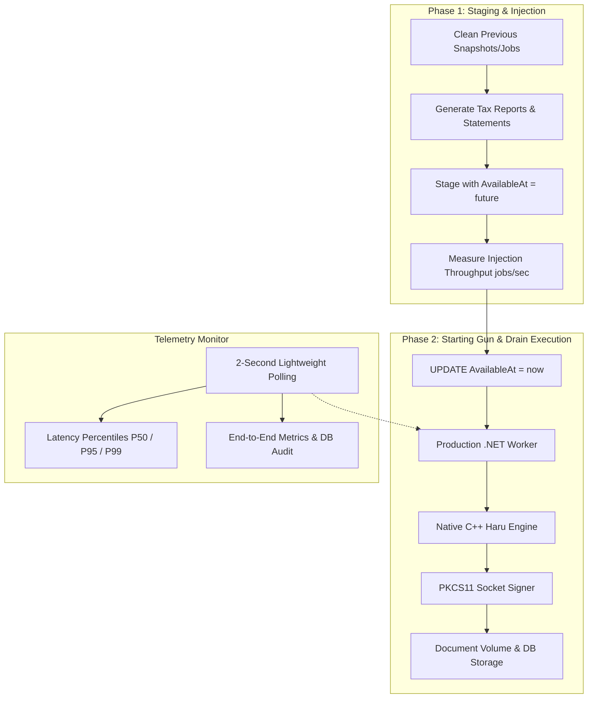

# Nordiska Reporting Pipeline Benchmark

Standalone Linux console application (written in C++23) to benchmark the end-to-end whole-database reporting batch pipeline against the production .NET worker container.

## Overview

Simulates a real bank end-of-year reporting batch job:
- **1 Annual Tax Report** per customer (for their primary account, aggregating interest paid and preliminary tax deducted).
- **1 Account Statement** per customer account (with all historical ledger entries, running balances, opening balance, and closing balance).
- Evaluates the **unmodified production `.NET` worker container** (`nordiska-v2-reporting-worker-1`), exercising:
  - Database job polling via `SKIP LOCKED`.
  - Snapshot verification and SHA-256 payload integrity matching .NET `Utf8JsonWriter`.
  - High-performance native PDF generation (`libpdf_generator.so` via libharu).
  - Socket-based PKCS#11 PDF signing via `nordiska-v2-pdf-signer-1`.
  - Document volume persistence in `/var/lib/nordiska/report-documents/`.
  - PostgreSQL document registration in `reporting.generated_documents`.

---

## Architecture: Two-Phase Execution



### 1. Phase 1: Timed Staging (Job Injection)
All snapshots, entries, and jobs are generated and staged in PostgreSQL using set-based atomic CTEs with `AvailableAt = now() + interval '1 day'`. The worker cannot pick up the jobs yet, isolating and measuring pure database injection throughput (`jobs/sec`).

### 2. Phase 2: The Starting Gun & Drain Execution
The benchmark fires the starting gun by releasing all staged jobs simultaneously:
```sql
UPDATE reporting.tax_report_jobs SET "AvailableAt" = now() WHERE "AvailableAt" > now();
UPDATE reporting.account_statement_jobs SET "AvailableAt" = now() WHERE "AvailableAt" > now();
```
The unmodified production worker immediately begins draining the queue using concurrent batch consumers.

### 3. Non-Contending Telemetry Polling (every 2 seconds)
Drain progress is monitored every 2 seconds via indexed status counts (`Completed`, `Processing`, `Pending`, `Failed`). This completely avoids lock or CPU contention with worker batch transactions.

Upon completion, exact timestamp spans (`MIN(StartedAt)` to `MAX(CompletedAt)`), wall-clock elapsed time, percentiles (P50, P95, P99), and database verification are reported.

---

## Quick Start

### Build the Tool
Run the build script from the repository root:
```bash
./tools/benchmark/build-linux-release.sh
```
This produces the standalone binary `tools/benchmark/nordiska-benchmark`.

### Interactive Controller (TUI)
Launch the unified benchmark controller to configure settings and run benchmarks:
```bash
./tools/benchmark/bench-tui.sh
```

### Direct CLI Mode
Run benchmarks directly from command line:
```bash
# Run benchmark on active database (all customers)
./tools/benchmark/nordiska-benchmark

# Quick sample benchmark (e.g. 100 customers)
./tools/benchmark/nordiska-benchmark --limit 100

# Benchmark with simulated TSA latency jitter (e.g. 60–100 ms)
./tools/benchmark/nordiska-benchmark --limit 100 --jitter 60-100

# Target a specific database
./tools/benchmark/nordiska-benchmark --db nordiska_synthetic
```

---

## Command-Line Options

| Option | Description | Default |
|---|---|---|
| `--limit <N>` | Limit benchmark to first N customers | `0` (unlimited, full database) |
| `--jitter <ms|min-max>` | Simulated TSA latency in ms (e.g. `80` or `60-100`) | Auto-detected from `.env` |
| `--db <name>` | Target PostgreSQL database name | Auto-detected from `infra/.env` |
| `--poll <seconds>`| Progress telemetry polling interval | `2` seconds |
| `--year <YYYY>` | Reporting tax & statement year | `2026` |
| `--no-clean` | Do not clean reporting tables before run | Disabled (cleans before staging) |
| `--no-save` | Do not write report to `runs/` folder | Disabled (saves to `runs/`) |
| `--help` | Show command line usage information | |

---

## Benchmark Results (Reference Run on Synthetic DB)

On `nordiska_synthetic` (**1,002 customers, 1,522 accounts, 71,283 transactions**):

```
================================================================================
                              BENCHMARK SUMMARY
================================================================================
Target Database:         nordiska_synthetic
Total Documents Staged:  2524 (1002 tax + 1522 statements)
--------------------------------------------------------------------------------
PHASE 1: STAGING (JOB INJECTION)
  Tax Jobs Staging:      260.7 ms
  Statement Jobs Staging:977.4 ms
  Total Injection Time:  1238.2 ms
  Injection Throughput:  2039 jobs/sec
--------------------------------------------------------------------------------
PHASE 2: DRAIN EXECUTION (PRODUCTION .NET WORKER)
  Wall-Clock Duration:   4.73 s
  Completed PDFs:        2524
  Failed Jobs:           0
  Wall-Clock Throughput: 533.1 PDFs/sec
  DB Span (Min->Max):    2.66 s (947.7 PDFs/sec db-measured)
  Document Latencies:    P50: 7.6 ms | P95: 13.8 ms | P99: 18.1 ms | Avg: 8.2 ms
  Verified in DB:        2524 documents in reporting.generated_documents
--------------------------------------------------------------------------------
TOTAL END-TO-END BATCH TIME (Staging + Drain): 5.97 s
================================================================================
```

For the comprehensive full-matrix benchmark report spanning up to **25,000 customers (63,400+ documents)** across various concurrency levels and signing configurations, see [Benchmark Report & Scalability Analysis](docs/benchmark-report.md).
